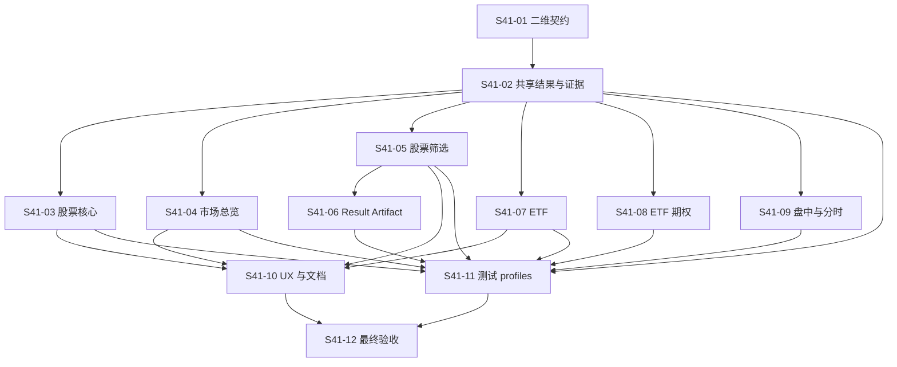

# Spec 0009：v0.4.1 实施任务清单

本文只定义后续实施任务、依赖和验收义务，不创建或修改 GitHub Issue，不代表任何任务已经认领、实现或验收。旧 Spec 0008 tickets 只作为历史证据和依赖来源，不继承其当前状态。

## 当前版本范围决定

`market_screen_research` 及其时点 Universe、批量因子、排名、候选深研和大型 screening artifact 链在 v0.4.1 暂缓，当前公共状态为 `unsupported`。S41-05/S41-06 等已存在的内部模块和离线测试保留为历史 provenance，不构成公共支持；S41-08/#133、S41-14/#139 和 S41-15/#140 的来源资格与发布门禁从本版本有效交付范围移出，保留延期原因和后续重启条件。公共入口继续在任何 source 或 artifact I/O 前拒绝 screening 请求。

## 任务总览

| ID | 任务 | 资产类别 / 场景 | 状态 | 优先级 | 硬依赖 |
|---|---|---|---|---|---|
| S41-01 | 二维产品契约和当前能力矩阵 | all / all | planned | P0 | — |
| S41-02 | 共享结果、evidence 和 Interface 边界 | all / evidence_result | planned | P0 | S41-01 |
| S41-03 | A 股普通股票核心链 | a_share_equity / identity、market、valuation、materials | planned | P0 | S41-02 |
| S41-04 | 市场总览链 | index、market_aggregate / market_observation、market_signals | planned | P0 | S41-02 |
| S41-05 | A 股筛选、Universe、因子和排名 | a_share_equity / screening_ranking | planned | P1 | S41-02 |
| S41-06 | Screening Result Artifact 生命周期 | a_share_equity / evidence_result | planned | P1 | S41-05 |
| S41-07 | ETF 行情边界 | etf / identity、market_observation | planned | P1 | S41-02 |
| S41-08 | ETF 期权隔离 | etf_option / identity、market_observation | planned | P2 | S41-02 |
| S41-09 | 盘中与分时扩展边界 | a_share_equity / market_observation | planned | P2 | S41-02 |
| S41-10 | UX、模板和当前文档收敛 | all / workflow_orchestration | planned | P0 | S41-03、S41-04、S41-05、S41-07 |
| S41-11 | 测试 profile 与发布证据边界 | all / evidence_result | planned | P0 | S41-02、S41-03、S41-04、S41-05、S41-06、S41-07、S41-08、S41-09 |
| S41-12 | 冻结候选和最终验收 | all / all | planned | P0 | S41-01 至 S41-11 |

## 任务定义

### S41-01：二维产品契约和当前能力矩阵

**Objective：** 建立 `asset_class × research_scene` 的唯一当前分类，并为每项能力声明 `status`、`priority`、入口和证据。

**Inputs → Outputs：** 现有 README、CONTEXT、workflow contract、Spec 0008 历史范围 → 当前 Spec、能力矩阵、兼容和延期清单。

**Acceptance evidence：** 每个已注册 task、workflow 和市场总览 capability 恰好映射到一个资产类别与研究场景；债券、一般基金和其他衍生品没有隐式支持；历史 Spec 未被改写。

### S41-02：共享结果、evidence 和 Interface 边界

**Objective：** 将身份、时点、来源、coverage、错误、冲突、限制和统一结果信封定义为跨域共享 Interface。

**Inputs → Outputs：** 当前结果协议和 evidence contract → 共享字段不变量、状态折叠规则、证据复用范围和模块拆分边界。

**Hard deps：** S41-01。

**Acceptance evidence：** 代表性结果保留统一 14-key envelope；`supported / limited / blocked`、`partial / unavailable / observed_empty` 和 unsupported reason code 的含义不变；任何资产类别不得绕过共享状态折叠。

### S41-03：A 股普通股票核心链

**Objective：** 收敛身份、行情、估值、材料、事件和单标的 workflow，作为 P0 主产品路径。

**Inputs → Outputs：** 当前窄任务和 workflow → 稳定的股票资产类别映射、主路径路由、专用 workflow 兼容清单。

**Hard deps：** S41-02。

**Acceptance evidence：** identity、trend、valuation、content、capital events 和 `single_security_research@1.0` 的 contract / failure matrix / copied-install smoke 通过；证券类别不明确时估值阻断；局部失败不丢失同级结果。

### S41-04：市场总览链

**Objective：** 稳定 `market_overview_research@2.0`，把指数、交易会话、市场信号和 unsupported 槽位作为独立市场聚合能力。

**Inputs → Outputs：** 当前 workflow-contract 和 market foundation → exact 15-entry inventory、fast/standard 计划、三项 unsupported 投影和 no-proxy 规则。

**Hard deps：** S41-02。

**Acceptance evidence：** fast 执行四项 core，standard 执行 core + standard；12 项 executable、3 项 unsupported 精确闭合；不生成证券排名，不以股票、ETF、指数或板块代理全市场值。

### S41-05：A 股筛选、Universe、因子和排名

**Objective：** 保留 `market_screen_research` 产品意图，重构为独立的三所 A 股股票筛选链。

**Inputs → Outputs：** Spec 0008 历史 screening 设计、现有 Universe 和 factor modules → 当前 screening contract、as-of 分母、unranked 语义和 deterministic ranking 规则。

**Hard deps：** S41-02。

**Acceptance evidence：** 仅包含 SSE/SZSE/BSE 人民币普通股票；expected = resolved + failed + 明确分区状态；非股票资产显式排除；缺失因子不补值；排名公式、Decimal 精度、并列和二级排序可复现。未完成前公共入口继续稳定拒绝。

### S41-06：Screening Result Artifact 生命周期

**Objective：** 使大型筛选结果在调用者显式目录中可创建、恢复、完成和审计。

**Inputs → Outputs：** S41-05 的 manifest、candidate result 和 evidence → create/resume/finalize、journal、manifest-last、篡改失败关闭和同 receipt 规则。

**Hard deps：** S41-05。

**Acceptance evidence：** apply 前验证失败保持零修改；完成文件、manifest 和摘要可独立复验；未知 residue、外部篡改和不一致状态失败关闭；同请求 resume 返回相同确定性 receipt。

### S41-07：ETF 行情边界

**Objective：** 将 ETF 作为独立资产类别保留，明确其不进入 A 股股票分母。

**Inputs → Outputs：** `etf_market` contract 和现有 source operations → ETF identity、单位、交叉核验和结果投影边界。

**Hard deps：** S41-02。

**Acceptance evidence：** SSE ETF 请求在复制安装中可运行；来源价格、涨跌、成交量和成交额单位可追溯；ETF 不被市场筛选和全市场股票聚合引用为代理。

### S41-08：ETF 期权隔离

**Objective：** 保留 ETF 期权实验能力，避免把期权字段混入 ETF 或股票模块。

**Inputs → Outputs：** `etf_options` contract → 合约身份、月份、到期、行权价、认购/认沽、标准/调整类型和限制矩阵。

**Hard deps：** S41-02。

**Acceptance evidence：** 标准与调整合约不混合；无报价不等于无合约；未知总量、来源失败和 observed empty 可区分；实验状态不被提升为股票或市场总览成功。

### S41-09：盘中与分时扩展边界

**Objective：** 保留当前盘中快照和已完成交易日分时复盘，并明确它们与市场总览、股票筛选的依赖隔离。

**Inputs → Outputs：** intraday contracts、session context 和 replay fixtures → current-session / completed-session、coverage、auction/session 和未实时验证矩阵。

**Hard deps：** S41-02。

**Acceptance evidence：** 当前快照不冒充收盘序列；缺失分钟不补零；停牌、不成交、partial 和 unavailable 可区分；未实时验证不写成来源成功。

### S41-10：UX、模板和当前文档收敛

**Objective：** 让 Agent 和用户按资产类别与研究场景选择入口，而不需要穿越历史 Spec 才能理解当前支持范围。

**Inputs → Outputs：** S41-01、S41-03、S41-04、S41-05、S41-07 的矩阵和契约 → 当前契约页、主路径路由、资产类别模板、历史资料索引。

**Hard deps：** S41-03、S41-04、S41-05、S41-07。

**Acceptance evidence：** active docs 不混用 v0.3.0/v0.4.0 当前状态；screening、overview、ETF 和 option 路由清晰；历史 evidence、Spec 和 ADR 原路径可回读；文档链接和模板校验通过。

### S41-11：测试 profile 与发布证据边界

**Objective：** 将 core、installed、screening、release 和 live 验证分开，避免普通 discover 把不同证据等级混为一次结果。

**Inputs → Outputs：** S41-02 至 S41-09 的验收义务 → profile 清单、共享 fixture、发布证据入口和 live opt-in 规则。

**Hard deps：** S41-02 至 S41-09。

**Acceptance evidence：** core 只验证公共契约；installed 验证复制安装；screening 验证分母、排名和 artifact；release 验证冻结候选证据；live 仅显式运行；测试不互相 import `test_*` fixture。

### S41-12：冻结候选和最终验收

**Objective：** 对一个 clean candidate 统一回读二维能力矩阵、实现状态、测试 profile、文档和分发结果。

**Inputs → Outputs：** S41-01 至 S41-11 → release readiness record、未完成项、延期项和准确的 v0.4.1 交付声明。

**Hard deps：** S41-01 至 S41-11。

**Acceptance evidence：** P0 全部通过；P1 明确已支持、仍拒绝或延期；P2 保留真实实验状态；P3 未进入公共分母；`uv` Python 3.14 开发环境验证完成，公共 runtime 仍保持 Python 3.12+ 契约；未通过的来源、live 或 release 证据不被重标。

## 依赖图

## 任务状态规则

所有任务初始为 `planned`。只有在对应代码、测试、文档和证据完成并独立 readback 后，才可转为 `accepted`。文档完成、静态 contract 通过或内部模块存在，都不能单独把任务标记为 `accepted`。
